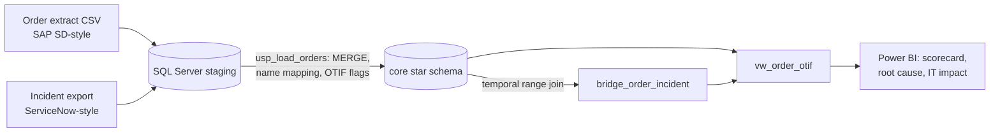

# OTIF Service-Level Analytics with Incident Root-Cause Linking

> **Portfolio project on simulated data.** Not employer or client work. Orders and incidents are generated by `src/gen_otif_data.py`, inspired by the order-to-cash applications I supported in application support.

**Question:** when retailer OTIF (On Time In Full) misses target, how much of the failure overlaps an IT incident, and which applications should the support team fix first?

## Results (simulated data, seed 7)
| Metric | Value |
|---|---|
| OTIF across 59,400 measured orders | **82.2%** (target 95%) |
| Late orders overlapping an open P1/P2 incident | **46%** |
| OTIF with no incident open vs during one | 87% vs 34% |
| Application linked to the most late orders | EDI Gateway (1,694) |

## Architecture


## What it does
1. **Ingestion:** orders and incidents into SQL Server staging (bulk insert or `pandas.to_sql`).
2. **Transformation** ([`sql/otif_model.sql`](sql/otif_model.sql)): customer-name mapping, MERGE upsert, OTIF flags, and missing proof-of-delivery kept in a data-quality bucket.
3. **Root-cause link:** a temporal range join ties each order to P1/P2 incidents on SAP SD, the EDI Gateway or the WMS that were open at the same plant (or globally), counting each order once.
4. **Analysis:** OTIF decomposition, failure-reason Pareto, OTIF with and without an open incident, orders impacted per application.
5. **Delivery:** a four-page Power BI report. DAX in [`dax_measures.md`](dax_measures.md).

## Run it locally
```bash
pip install -r requirements.txt
python src/gen_otif_data.py     # writes data/*.csv
python src/otif_analysis.py     # prints metrics, writes dashboard_data_otif.json
```
To use SQL Server, load the CSVs into `stg.orders` / `stg.incidents`, then run `sql/otif_model.sql`. Open `dashboard/report-prototype.html` to preview the report layout.

## Tech stack
SQL Server · T-SQL · Python (pandas) · Power BI · DAX · Power Query
